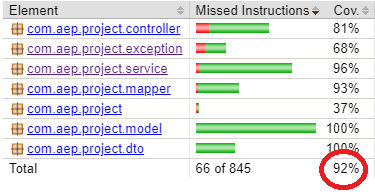
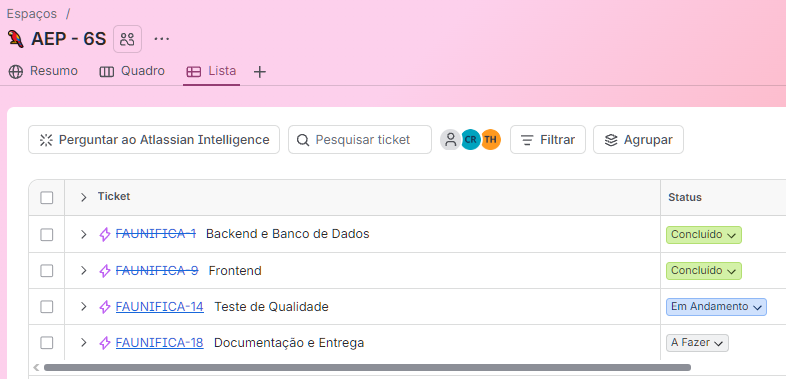

# Faunifica 🦜

PoC para **cadastro e consulta de espécies de animais silvestres e suas observações**, com o objetivo de organizar informações básicas sobre a fauna e facilitar o acesso a dados relacionados à biodiversidade.

## 🌱 Problema

Informações sobre espécies de animais silvestres podem estar dispersas e pouco organizadas, dificultando sua consulta e o acesso a dados básicos sobre a fauna. O Faunifica propõe uma forma simples de centralizar essas informações em uma aplicação.

## 🌎 ODS 15 — Vida Terrestre

O projeto está alinhado à **ODS 15 — Vida Terrestre**, que busca proteger, recuperar e promover o uso sustentável dos ecossistemas terrestres, além de combater a perda de biodiversidade.

O Faunifica contribui de forma indireta para esse objetivo ao organizar e facilitar a consulta de informações sobre espécies silvestres, incluindo dados como nome popular, nome científico, grupo, bioma, nível de risco e população estimada, além de permitir o registro de observações relacionadas a essas espécies.

## 💡 Evolução da Prova de Conceito

A primeira entrega consistiu em uma aplicação web integrada a uma API REST para gerenciamento de espécies, contemplando as operações básicas de cadastro, consulta, atualização e exclusão (CRUD).

Na **segunda entrega**, a PoC foi ampliada com novas funcionalidades e melhorias:

* Cadastro, listagem, consulta, atualização e exclusão de espécies;
* Pesquisa de espécies por nome popular;
* Filtros combináveis por grupo, bioma e nível de risco;
* Cadastro e listagem de observações;
* Consulta de observações por identificador;
* Consulta de observações associadas a uma espécie;
* Exclusão de observações;
* Ampliação da modelagem NoSQL, com uma segunda collection e documentos aninhados;
* Expansão dos testes automatizados e da cobertura de código.

## 🏗️ Arquitetura

* **Controller:** recebe e responde às requisições HTTP;
* **Service:** concentra as regras e operações da aplicação;
* **Repository:** realiza o acesso ao MongoDB;
* **Model:** representa as entidades e enumerações utilizadas;
* **DTO:** define os dados de entrada e saída da API;
* **Mapper:** realiza a conversão entre DTOs e entidades;
* **Exception:** centraliza o tratamento de exceções da aplicação.

## 🛠️ Tecnologias

* Java 21
* Spring Boot 4.1.0
* Spring Data MongoDB
* MongoDB 8
* HTML, CSS e JavaScript
* Docker
* Maven
* JUnit 5
* Mockito
* MockMvc
* JaCoCo
* Git e GitHub

## 🗄️ Banco de Dados

O projeto utiliza o **MongoDB**, banco de dados NoSQL orientado a documentos. O MongoDB é executado através do Docker Compose.

A aplicação utiliza o banco:

```text
faunifica
```

Nesta segunda entrega, são utilizadas duas collections:

### Collection especies

Armazena os documentos referentes às espécies cadastradas, com informações como:

* Nome popular;
* Nome científico;
* Grupo;
* Bioma;
* Nível de risco;
* População estimada.

### Collection observacoes

Armazena observações relacionadas às espécies. Cada documento possui informações como:

* especieId: identificador da espécie relacionada;
* dataObservacao: data e horário da observação;
* localizacao: objeto com informações de localização;
* detalhes: objeto com informações complementares;
* registros: lista de registros relacionados à observação.

A collection observacoes possui objetos incorporados e uma lista de subdocumentos. De forma ilustrativa, sua estrutura pode ser representada assim:

```
observacoes
└── documento de observação
    ├── _id
    ├── especieId
    ├── dataObservacao
    ├── localizacao
    │   ├── municipio
    │   └── estado
    ├── detalhes
    │   ├── quantidadeObservada
    │   └── descricao
    └── registros
        ├── registro 1
        │   ├── tipo
        │   └── descricao
        ├── registro 2
        │   ├── tipo
        │   └── descricao
        └── ...
```

## ▶️ Execução

### Pré-requisitos

* Java 21
* Maven
* Docker Desktop com suporte ao WSL 2

### 1. Inicie o MongoDB

Na pasta do projeto:

```bash
docker compose up -d
```

### 2. Execute a aplicação

No IntelliJ ou através do Maven:

```bash
mvn spring-boot:run
```

A aplicação estará disponível, por padrão, em:

```text
http://localhost:8080
```

O frontend pode ser acessado diretamente pelo navegador através desse endereço.

## 🧪 Testes automatizados

O projeto possui testes automatizados utilizando JUnit 5, Mockito e MockMvc.

Para executar os testes, utilize:

```bash
mvn clean test
```
O Docker precisa estar em execução antes.  
Ao final da execução, o Maven deve indicar que os testes foram executados com sucesso.

## 📊 Cobertura de testes

A cobertura de código é medida utilizando o **JaCoCo**.

Após executar o Docker e o:

```bash
mvn clean test
```

o relatório será gerado no arquivo:

```text
target/site/jacoco/index.html
```

Abra o arquivo `index.html` para visualizar as estatísticas de cobertura, incluindo linhas, métodos e classes.

A AEP estabelece como requisito uma cobertura mínima de 70% em cada entrega.  

Na segunda entrega, o projeto atingiu 92% de cobertura, superando o percentual mínimo estabelecido.

**Evidência da cobertura — Segunda entrega:**



## 🖥️ Como testar a PoC

Após iniciar o MongoDB e executar a aplicação, acesse:

```text
http://localhost:8080
```

### Cadastro

1. Clique em **+ Nova espécie**.
2. Preencha os campos solicitados.
3. Clique em **Cadastrar espécie**.
4. Verifique se a espécie aparece na tabela.

### Pesquisa e filtros

1. Digite um nome popular no campo de pesquisa para localizar espécies.
2. Utilize os filtros de grupo, bioma e nível de risco.
3. Combine os filtros para refinar os resultados.
4. Limpe os campos de pesquisa e filtros para retornar à listagem completa.

### Consulta

1. Clique em **Ver mais** em uma espécie.
2. Verifique os dados apresentados no modal.

### Atualização

1. No modal de detalhes, clique em **Atualizar**.
2. Altere um ou mais campos.
3. Clique em **Salvar**.
4. Verifique se os dados foram atualizados na tabela.

### Exclusão

1. Abra o modal de detalhes de uma espécie.
2. Clique em **Deletar**.
3. Confirme a exclusão.
4. Verifique se a espécie foi removida da tabela.

### Cadastro de uma observação

1. Na seção Observações, clique em **+ Nova observação**.
2. No campo **Espécie**, selecione a espécie à qual a observação será associada.
3. Na seção **Localização**, informe o município e a sigla do estado (UF).
4. Na seção **Detalhes**, informe a quantidade observada e uma descrição da observação.
5. Em **Registros complementares**, caso deseje, clique em **+ Adicionar registro** para incluir informações adicionais, como comportamento ou características observadas.
6. Para cada registro complementar adicionado, preencha os campos Tipo e Descrição. Essa etapa é opcional.
7. Clique em **Cadastrar observação**.
8. Após a confirmação do cadastro, verifique se a observação aparece na tabela.

### Consulta e exclusão

1. Na tabela de observações, utilize o campo de pesquisa para localizar registros pelo nome popular da espécie.
2. Utilize a ação de consulta da observação para visualizar seus detalhes, incluindo espécie, data, localização, quantidade observada, descrição e registros complementares.
3. Para excluir uma observação, utilize a ação de exclusão correspondente e confirme a operação.

As observações armazenam informações complementares, incluindo localização, detalhes e uma lista de registros, conforme a modelagem descrita na seção de banco de dados.

## 🔗 Principais endpoints

### Espécies

| Método | Endpoint                    | Descrição                   |
| ------ |-----------------------------|-----------------------------|
| POST   | `/especies`                 | Cadastra uma espécie        |
| GET    | `/especies`                 | Lista as espécies           |
| GET    | `/especies?nomePopular=...` | Pesquisa por nome popular   |
| GET    | `/especies?grupo=...`       | Filtra por grupo            |
| GET    | `/especies?bioma=...`       | Filtra por bioma            |
| GET    | `/especies?nivelRisco=...`  | Filtra por nível de risco   |
| GET    | `/especies/{id}`            | Consulta uma espécie por ID |
| PUT    | `/especies/{id}`            | Atualiza uma espécie        |
| DELETE | `/especies/{id}`            | Exclui uma espécie          |

Os parâmetros de pesquisa podem ser combinados em uma mesma requisição. Por exemplo:

```
GET /especies?grupo=AVE&bioma=AMAZONIA&nivelRisco=ALTO
```

Os valores dos filtros devem corresponder às constantes definidas nos enums da aplicação.

### Observações

| Método | Endpoint                           | Descrição                           |
|--------|------------------------------------|-------------------------------------|
| POST   | `/observacoes`                     | Cadastra uma observação             |
| GET    | `/observacoes`                     | Lista as observações                |
| GET    | `/observacoes/{id}`                | Consulta uma observação por ID      |
| GET    | `/observacoes/especie/{especieId}` | Lista as observações de uma espécie |
| DELETE | `/observacoes/{id}`                | Exclui uma observação               |

## 📋 Metodologia de desenvolvimento

O desenvolvimento da segunda entrega foi acompanhado por meio de um quadro de tarefas, organizado em quatro Epics para dividir e acompanhar as atividades do projeto.

O quadro permitiu acompanhar o planejamento, a implementação, os testes e os ajustes finais da aplicação.



As demais evidências, registradas ao longo do desenvolvimento, estão disponíveis em [`docs/evidencias/quadro-tarefas/`](docs/evidencias/quadro-tarefas/).

## 🏷️ Versões da entrega

O repositório mantém a identificação das versões desenvolvidas para a AEP:

- **Primeira entrega:** identificada pela tag entrega-1.
- **Segunda entrega:** identificada pela tag entrega-2. Corresponde à versão atual evoluída da PoC, com novas funcionalidades, ampliação da modelagem NoSQL e atualização dos testes automatizados.
